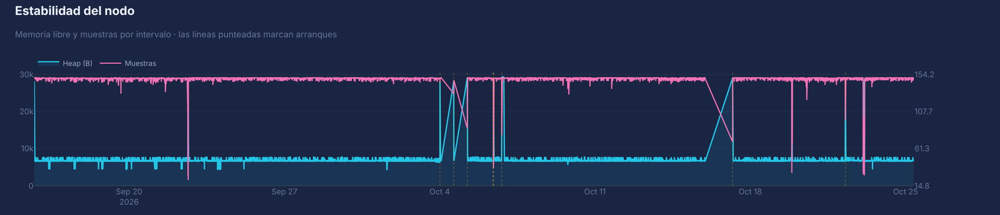
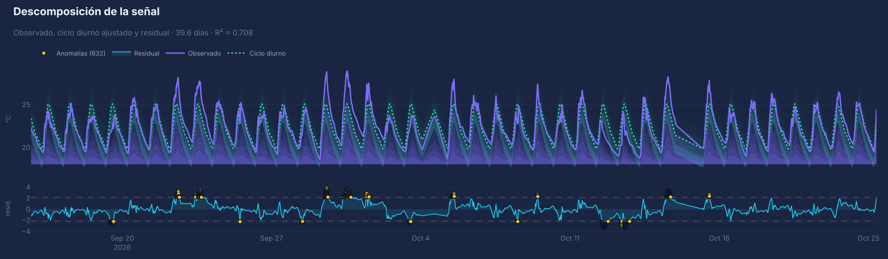
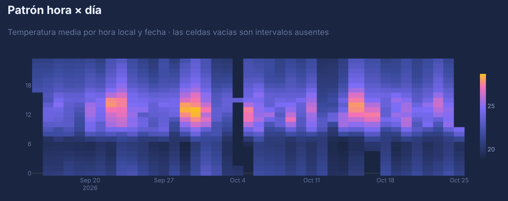
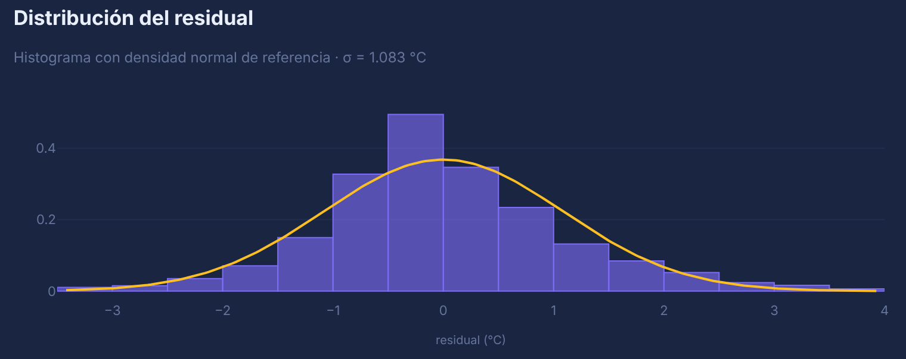
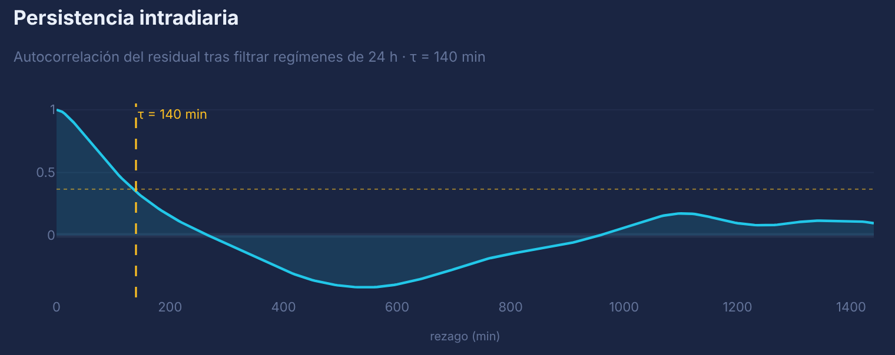
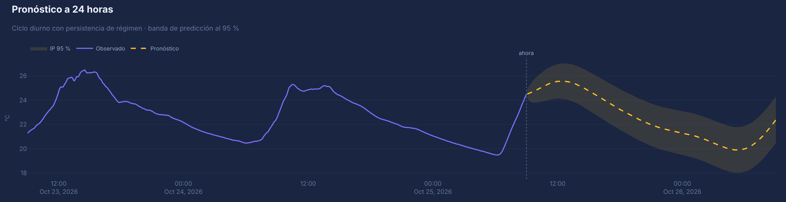
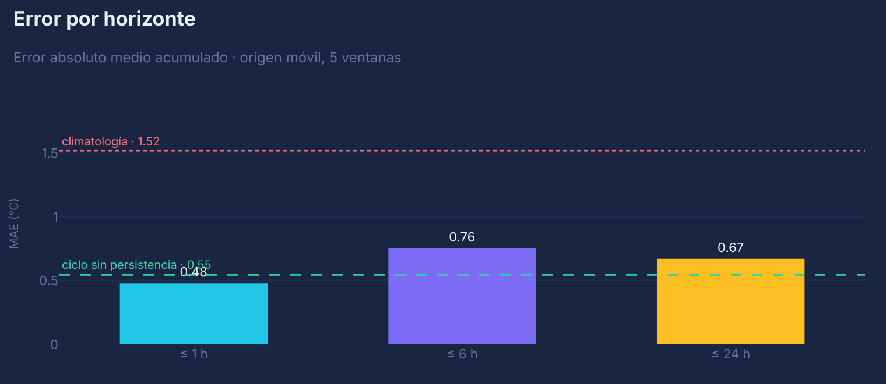

# Resultados de la campaña

<!-- Generado por analysis/tools/exportar_figuras.py el 2026-10-25 15:38 UTC. No editar a mano. -->

**Nodo:** `ues-b1c9fe`  
**Período:** 2026-09-15 17:25 a 2026-10-25 09:00 (hora local) · 39.6 días  
**Estado de calibración:** sin calibrar

## Operación

| Indicador | Valor |
|---|---|
| Registros válidos | 10672 de 10712 (99.6 %) |
| Completitud | 93.5% |
| Interrupciones | 14 · 748 intervalos · 63.5 h |
| Arranques | 10 · 0 espontáneos |
| Intervalos recuperados por la cola persistente | 766 |
| Intervalos con sonido saturado (marcados) | 22.0 % |
| Memoria libre mínima | 4400 B · deriva +0.3 B/h |

## Señal

| Magnitud | Valor |
|---|---|
| Varianza explicada por el ciclo diurno | 0.708 |
| Dispersión residual | 1.083 °C |
| Amplitud diurna | 4.50 °C |
| Pendiente global | -0.0005 °C/día |
| Tendencia incorporada | no — pendiente por debajo del umbral de relevancia (0.1 °C/día); se excluyen derivas mayores que 0.036 °C/día |
| IC 95 % de la pendiente | [-0.0260, +0.0251] °C/día |
| Pendiente mínima detectable (α = 0.05, potencia 0.80) | 0.0363 °C/día |
| Autocorrelación de primer orden | 0.9982 |
| Tamaño efectivo de muestra | 54 de 10672 |

## Escalas temporales del residual

| Magnitud | Valor |
|---|---|
| Tiempo de decorrelación intradiario | 140 min |
| Tiempo de decorrelación del residual completo | 735 min |
| Fracción sinóptica de la varianza residual | 59% |
| Dispersión sinóptica | 0.807 °C |
| Dispersión intradiaria | 0.668 °C |
| Correlación entre jornadas consecutivas | +0.46 |
| Cadencia de transmisión sugerida | 45 min |

El tiempo de decorrelación del residual completo incorpora regímenes de varios días y crece con la longitud del registro: describe el período observado, no el proceso. El de la componente intradiaria, obtenido tras un filtro pasa altos de 24 h, es el que fija la cadencia de muestreo.

## Pronóstico

Validación de origen móvil sobre 5 ventanas de 24 h, cada una pronosticada con parámetros estimados exclusivamente sobre los datos que la preceden.

| Métrica | Valor |
|---|---|
| Error absoluto medio | 0.673 °C |
| Raíz del error cuadrático medio | 0.793 °C |
| Sesgo | +0.054 °C |
| Destreza frente a la climatología | +0.557 |
| Destreza frente al ciclo sin persistencia | -0.231 |
| Cobertura de la banda | 95.5% (nominal 95%) |

| Horizonte | Error absoluto medio |
|---|---|
| ≤ 1 h | 0.478 °C |
| ≤ 6 h | 0.755 °C |
| ≤ 24 h | 0.673 °C |

El error a horizontes cortos no constituye por sí solo evidencia de destreza: debe contrastarse con la persistencia ingenua del último valor.

---

**Alcance.** Lecturas sin corrección por calibración. La incertidumbre reportada recoge solo la dispersión intra-intervalo y constituye una cota inferior: la componente de calibración permanece indeterminada hasta completar la co-ubicación con una referencia trazable. Estos valores no deben emplearse con fines normativos.
